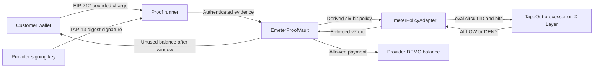

# Architecture

The first milestone proves that the vault's token transfer depends on the real TapeOut circuit decision on X Layer. The proof vault has one customer, one provider, one immutable price, one hard budget, and one fixed settlement window.

`DemoUSD` is a zero-value, six-decimal ERC-20 with restricted minting and a fixed supply cap. Deployment pays native OKB protocol fees and gas; customer payment tests use DEMO.

## Policy inputs

`ALLOW = A ∧ B ∧ C ∧ D ∧ (E ∨ F)`

| Bit | Input | Vault source |
| --- | --- | --- |
| 0 | A: service authorized | Authorization service ID matches immutable configured service ID. |
| 1 | B: receipt verified | Signed TAP-13 response reports `ok=true`, recovers to the fixed provider signer, and binds the authorized request and result. |
| 2 | C: charge authorized | EIP-712 signature recovers to the customer; immutable price is within the customer's signed maximum. |
| 3 | D: session active | Funds are not refunded and settlement is within the locked window. Reported execution time must precede session expiry. |
| 4 | E: within soft limit | `spent + price <= softLimit`, computed with integer arithmetic. |
| 5 | F: explicit override | Customer's valid charge signature covers `overrideSoftLimit=true`. |

The client never supplies arbitrary policy booleans to the vault. Balances, hard budgets, authorization expiry, receipt freshness, request binding, and consumed IDs/nonces are checked before circuit evaluation. A soft-limit denial remains a genuine circuit decision even when all hard constraints and signatures are valid.

The adapter checks factory registration, the actual processor's factory link, exact circuit metadata, and the generated netlist hash at construction. Every evaluation checks registration, processor/implementation code hashes, beacon implementation, metadata, and netlist bytes. Calls use bounded gas and fixed-size return buffers. Only canonical ABI-encoded `0x01` permits payment.

The vault consumes a request and nonce only after an allowed verdict. A denied charge can be retried with a newly signed explicit override; it cannot be settled twice. Refunds require the settlement window to end, preventing unused funds from being withdrawn while outstanding authorizations remain settleable.

## Next payment-engine milestone

Replace the isolated proof with `EmeterRegistry` and a multi-customer `EmeterVault`, add delegated capped session signing keys and price versions, then integrate two paid HTTP services. Gateway, SDK, database/indexer, receipt lifecycle, and full application UI follow. The database will index chain state rather than define available funds.
