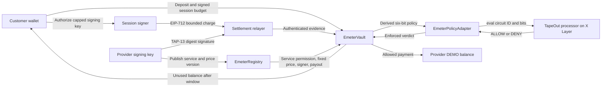

# Architecture

The payment engine extends the original circuit proof with a service registry and a multi-customer vault. `EmeterRegistry` records allowlisted providers and immutable price versions. `EmeterVault` holds prepaid credit, locks customer-signed session budgets, verifies delegated request signatures and provider receipts, and enforces the real TapeOut verdict before each token transfer. The original `EmeterProofVault` remains a separate, historical proof deployment.

`DemoUSD` is a zero-value, six-decimal ERC-20 with restricted minting and a fixed supply cap. Deployment pays native OKB protocol fees and gas; customer payment tests use DEMO.

## Policy inputs

`ALLOW = A ∧ B ∧ C ∧ D ∧ (E ∨ F)`

| Bit | Input | Vault source |
| --- | --- | --- |
| 0 | A: service authorized | Service is in the customer's signed service set; provider, service, and selected price version remain enabled in the registry. |
| 1 | B: receipt verified | TAP-13 digest signature reports `ok=true`, recovers to the selected price version's provider signer, and binds the authorized request and result. |
| 2 | C: charge authorized | EIP-712 signature validates against the session key; the selected version's fixed price is within the signed request maximum. |
| 3 | D: session active | Funds are not refunded and settlement is within the locked window. Reported execution time must precede session expiry. |
| 4 | E: within soft limit | `spent + price <= softLimit`, computed with integer arithmetic. |
| 5 | F: explicit override | A separate customer-signed EIP-712 grant binds this exact charge digest and caps resulting cumulative spending. The delegated key cannot approve its own override. |

The client never supplies arbitrary policy booleans to the vault. Balances, hard budgets, authorization expiry, receipt freshness, request binding, and consumed IDs/nonces are checked before circuit evaluation. A soft-limit denial remains a genuine circuit decision even when all hard constraints and signatures are valid.

The adapter checks factory registration, the actual processor's factory link, exact circuit metadata, and the generated netlist hash at construction. Every evaluation checks registration, processor/implementation code hashes, beacon implementation, metadata, and netlist bytes. Calls use bounded gas and fixed-size return buffers. Only canonical ABI-encoded `0x01` permits payment.

The vault consumes a session-scoped request ID, charge nonce, and provider receipt digest only after an allowed verdict. A denied charge can be retried with a customer-signed override; it cannot be settled twice. Monetary values use integer token base units throughout Solidity, shared schemas, SDK reads, and deployment reports.

## Session accounting and closure

Deposits become customer-owned available credit. A customer signature locks exactly the granted budget and records a canonical set of at most sixteen services, a signing key, per-request cap, soft limit, execution expiry, and settlement window. Creating a session cannot borrow another customer's credit or enlarge a signed grant. Customer and session-key authorization support EIP-1271 contract wallets as well as EOAs.

Price versions preserve the signer, payout, container identity, and exact price quoted to a request. Publishing a newer version does not rewrite an outstanding authorization. Providers or the registry owner can explicitly disable a compromised version, service, or provider; disabling it blocks settlement.

Closing a session stops newly reported execution but preserves its original `expiresAt + settlementWindow` refund deadline. Recently reported work from before the execution deadline may still settle during that window. Emergency key revocation deliberately invalidates pending charges without releasing locked funds early. After the original window, anyone may relay a refund, but the destination is always the recorded customer. Available credit is separately withdrawable by its owner. The vault has no administrator withdrawal function.

## Integration boundary

`EmeterSessionClient` reads live quotes and balances, prepares session and charge typed data, and produces signed session transaction calldata. The payment-engine proof exercises these methods with actual computations and onchain transactions. Its local JSON validation and word count are separate from the hosted AI Text Analyzer and JSON Validator.

The [paid gateway and SDK](gateway.md) implement wallet authentication, session/provider credentials, JSON validation, actual Otari AI analysis, TAP-13 responses, non-streaming usage evidence, PostgreSQL records, BullMQ execution/settlement jobs, and chain reconciliation. A session lock and fresh vault reads reserve each signed price; the database does not define available funds. Unknown provider completions retain reservations until recovery or expiry. Only verified canonical settlement events change payment status to settled, and the SDK independently confirms the transaction and receipt.

The production gateway uses Convex HTTP actions and internal Node actions around those Fastify handlers. A Prisma-shaped adapter buffers changes and commits them atomically against table epochs and fenced leases that span RPC reads and transaction signing. Amounts remain exact integer strings; dates and BigInts are explicitly serialized. Durable scheduler jobs preserve deduplication, worker ownership, retries, concurrency limits, and recovery of stale work. The PostgreSQL/BullMQ runtime remains available locally.

Bearer credentials are hashed in the HTTP action before entering Node action arguments. Issued credentials are generated at that same HTTP boundary; raw values do not enter durable records or scheduled job arguments. Dedicated provider and relayer keys live in Convex environment configuration. The existing operator signer remains external and local. A separate durable AI ledger caps total estimated/reported spending at $0.01 and retains unknown costs.

Maintenance scans at most four 100-block batches per invocation, matching both public RPCs' log range limit. Idle maintenance runs every 60 seconds; requests and pending work trigger faster passes. A stale heartbeat/cursor, wrong contract identity, or noncanonical cursor blocks paid execution. Rebuilding pauses dispatch and broadcasts while preserving original signed evidence.

Three production HTTP requests now have independently verified mainnet settlements: two JSON computations and one actual Otari response. They paid 0.09 DEMO and refunded 0.01 DEMO directly to the fixed customer after the original deadline. [Gateway mainnet verification](evidence/gateway-mainnet-verification.json) includes both RPCs, request/payment bindings, and exact accounting.

The [light sidebar interface](frontend.md) uses actual gateway/chain records, a persistent desktop sidebar and accessible phone icon rail, exact wallet deposits, tab-only delegated keys, scoped credentials, retained request/transaction recovery, and independently verified receipt-driven circuit inputs. Its complete browser proof uses a disposable historical fork and labeled offline AI fixture. [Payment-engine verification](payment-engine.md) retains the original deployment evidence.
